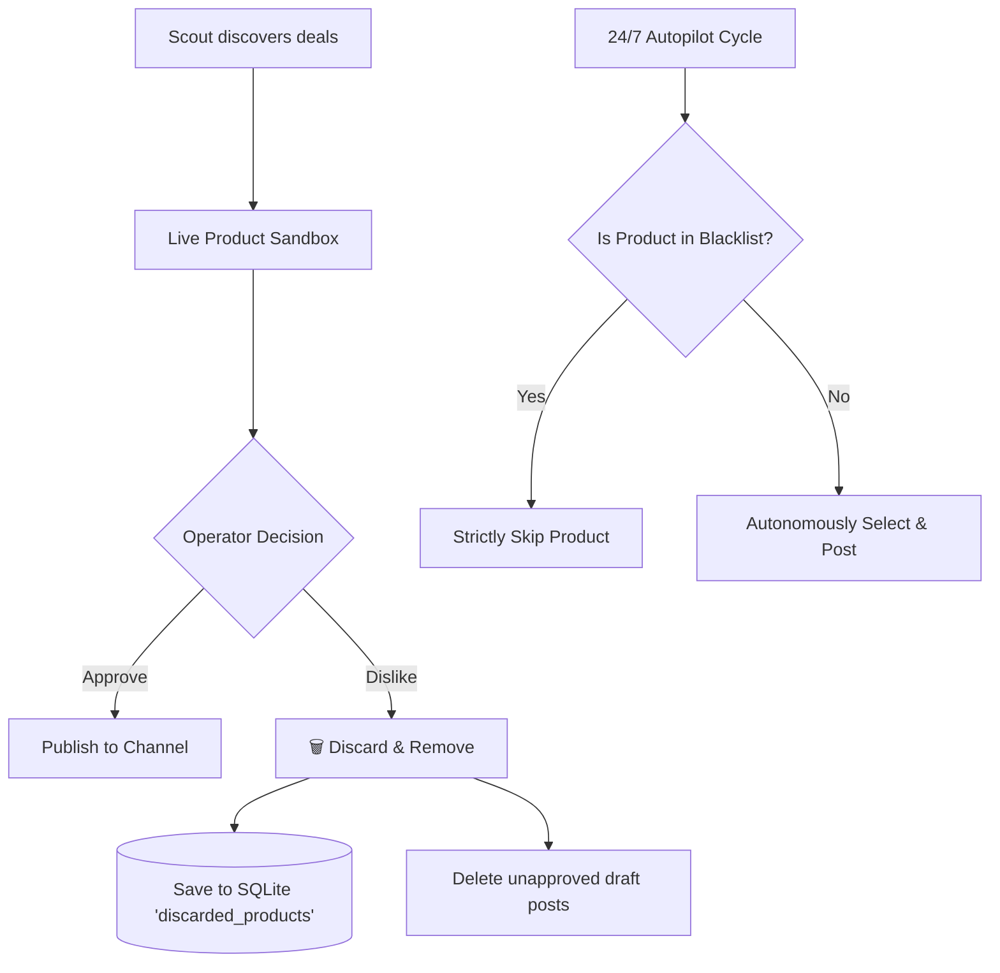
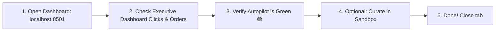

# AutoAffiliate AI — Comprehensive System Wiki & Operations Manual


AutoAffiliate AI is a production-ready, autonomous multi-agent business operations platform. It continuously scouts live products from e-commerce stores, generates high-converting multimedia assets (multi-slide carousels featuring dedicated brand ambassador avatars and 15-second vertical AI Reels with neural voiceovers), cloaks affiliate links to safeguard follower trust, publishes across social media channels, and engages leads via automated direct messages.


---


## 📑 Table of Contents

1. [System Architecture & Agent Roster](#1-system-architecture--agent-roster)

2. [Brand Ambassador Avatar & Multi-Slide Carousel System](#2-brand-ambassador-avatar--multi-slide-carousel-system)

3. [E-Commerce Deal Sourcing & Multi-Store Aggregator (EarnKaro)](#3-e-commerce-deal-sourcing--multi-store-aggregator-earnkaro)

4. [Affiliate Link Privacy & Automated URL Cloaking](#4-affiliate-link-privacy--automated-url-cloaking)

5. [1-Day Auto-Storage Janitor Bot](#5--1-day-auto-storage-janitor-bot-automatic-media-purge)

6. [Product Curation, Discard & Blacklist Engine](#6-product-curation-discard--blacklist-engine)

6. [24/7 Autonomous Autopilot & Anti-Spam Jitter Pacing](#6-247-autonomous-autopilot--anti-spam-jitter-pacing)

7. [100% Humanoid Social Copywriting & Auto-DM Funnel](#7-100-humanoid-social-copywriting--auto-dm-funnel)

8. [Social Media Setup & Production Launch Playbook](#8-social-media-setup--production-launch-playbook)

9. [Admin Dashboard User Guide & In-Table Spreadsheet Operations](#9-admin-dashboard-user-guide--in-table-spreadsheet-operations)

10. [Daily Operator Workflow & Maintenance](#10-daily-operator-workflow--maintenance)


---


## 1. System Architecture & Agent Roster


AutoAffiliate AI is built around a collaborative team of specialized autonomous agents coordinated by a central orchestrator:


```mermaid

graph TD

    User([Admin / Business Operator]) --> Orchestrator[Agent Orchestrator]

    Daemon[24/7 Background Daemon] --> Orchestrator

    

    Orchestrator --> Scout[Scout Agent]

    Orchestrator --> Creative[Creative Studio Agent]

    Orchestrator --> Marketer[Marketer & Growth Agent]

    

    Scout --> Scraper[Multi-Store Scraper (Amazon, Flipkart, EarnKaro)]

    Scout --> Tagger[Official Amazon & Direct Affiliate Tagger]

    

    Creative --> ImgGen[Dual-Card Carousel Generator]

    Creative --> VidGen[Vertical Reel & Edge-TTS Compiler]

    

    Marketer --> MetaPub[Meta Graph API (IG & FB)]

    Marketer --> LeadDM[Inbound Comment Auto-DM Funnel]

    Marketer --> Organic[Organic Audience Growth Engine]

    

    Orchestrator --> SQLite[(SQLite Database: autoaffiliate.db)]

```


### Agent Roles:

1. **Agent Orchestrator (`core/orchestrator.py`)**:

   - Manages channel profiles, traffic routing, dynamic revenue target calculations, live testing, product discard blacklisting, and natural language command processing.

2. **Scout Agent (`agents/scout_agent.py`)**:

   - Connects to real-time e-commerce APIs and scrapers (Amazon India, Flipkart, EarnKaro 150+ network).

   - Computes estimated commission per sale and dynamically calculates units needed to reach the daily profit goal ₹X.

3. **Creative Studio Agent (`agents/creative_agent.py`)**:

   - Generates 100% humanoid copy (zero emojis, zero special characters).

   - Creates multi-image carousels with brand avatar cards and real store pictures.

   - Compiles vertical 9:16 vertical AI Reels with dynamic text and neural audio voiceover.

4. **Marketer Agent (`agents/marketer_agent.py`)**:

   - Dispatches posts to Instagram, Facebook Pages, and Telegram channels.

   - Listens for "Comment LINK" leads and delivers instant, personalized direct messages with cloaked referral URLs.

   - Executes daily organic audience growth tasks (liking, commenting, inviting prospects).

5. **Autonomous Daemon (`core/auto_daemon.py`)**:

   - Background worker running independent cycles with non-fixed anti-spam jitter intervals.

6. **Cleaner Agent (`agents/cleaner_agent.py`)**:

   - 24-hour disk janitor bot that automatically purges generated video and image files after 1 day to conserve cloud storage, while permanently retaining database records, captions, and commission history.


---


## 2. Brand Ambassador Avatar & Multi-Slide Carousel System


To establish authentic brand identity and prevent posts from looking like generic spam, AutoAffiliate AI enforces a strict brand visual standard:


```
+-------------------------------------------------------------+
| (O) ELENA'S WORLD • CURATED STYLE PICK        [Slide 1 of 5]|
|     VERIFIED HIGH-VALUE FIND • 100% AUTHENTIC               |
+-------------------------------------------------------------+
| [REAL STORE PICTURE • CURATED BY ELENA]      [FLAT 75% OFF] |
|                                                             |
|                                                             |
|           [ FULL-WIDTH REAL SCRAPED PRODUCT PHOTO ]         |
|           (Genuine Amazon/Flipkart/Myntra Store Image       |
|            in high resolution - True Colors & Fabric)       |
|                                                             |
| [Rating: 4.7 / 5.0 • 3,200+ Orders]                         |
+-------------------------------------------------------------+
|   Deal: Rs 1,499   MRP: Rs 5,999   Save Rs 4,500 (75% OFF)  |
|          Pure Silk Kanjivaram Traditional Zari Saree        |
+-------------------------------------------------------------+
|    SWIPE TO SEE ALL 5 REAL STORE PHOTOS & ANGLES >>         |
+-------------------------------------------------------------+
```

### Strict Brand Ambassador Rules:

1. **Slide 1 (Full-Width Real Store Product Showcase)**:

   - Features the 100% authentic scraped store photo across the full width in high resolution, displaying the true product, model, fabric, and colors without clothing or body mismatches.

   - Elena is featured as a circular brand ambassador watermark badge (gold-ringed avatar in the header corner), establishing brand authority as the trusted style curator.

   - Scraped store badges include `"REAL STORE PICTURE • CURATED BY ELENA"`, prominent discount badge (`"FLAT X% OFF"`), and customer review metrics.

   - Clear price block displays Deal Price, MRP strikethrough, total savings, and units-to-goal tracking.

2. **Slides 2 to N (Real Scraped Store Gallery)**:

   - Every subsequent slide is dedicated 100% to displaying real gallery photos extracted from the store page (front drape, fabric texture, border close-up, pallu design, packaging).

   - Includes angle tags (e.g., `Slide 2 of 5: Fabric Weave & Border Detail`), brand watermark badge, and offer price recap.


---


## 3. E-Commerce Deal Sourcing & Multi-Store Aggregator (EarnKaro)


AutoAffiliate AI eliminates hardcoded dictionaries. All products, prices, discounts, ratings, and gallery images are retrieved live from e-commerce platforms.


### Supported Platforms:

1. **Amazon India**:

   - Scrapes live bestsellers and search results.

   - Automatically tags URLs with your official Amazon Associate tag (`tinkukrishnan-21`).

2. **Flipkart**:

   - Direct live deal scraping with discount extraction.

3. **EarnKaro Master Aggregator (150+ Indian Stores)**:

   - Configured with Publisher ID: **`5736594`**.

   - Enables earning commissions from 150+ Indian platforms with zero individual approvals required:

     - **Flipkart**

     - **Myntra** (Apparel, ethnic wear, shoes)

     - **Nykaa & Nykaa Man** (Cosmetics, skincare, perfumes)

     - **Ajio** (Trendy youth fashion)

     - **Mamaearth & The Derma Co** (Organic beauty)

     - **Croma & Samsung** (Electronics, appliances)

     - **Tata 1mg** (Health & wellness)

4. **Runtime Platform Extensibility**:

   - Operators can register ANY new e-commerce website (e.g. Bewakoof, Purplle, Meesho) directly from the dashboard without touching code.


---


## 4. Affiliate Link Privacy & Automated URL Cloaking


Followers and social media platform algorithms are sensitive to commercial tracking links. Exposing raw tracking parameters often leads to lower reach or decreased trust.


### Privacy & Cloaking Architecture:

1. **Strict Follower Privacy**:

   - Followers, commenters, and social algorithms **NEVER see `earnkaro.com` strings**.

2. **Official Direct & Short Referral Engine (`tools/affiliate_tagger.py`)**:

   - Uses official Amazon short links (`https://amzn.to/...`) and clean direct Associate URLs (`https://www.amazon.in/dp/ASIN?tag=tinkukrishnan-21`). Zero 3rd-party shortener clutter.

   - Includes memory caching (`_url_cache`) to prevent redundant network requests.

3. **Two-Tier Link Architecture**:

   - **Public Deal Link (Follower-Facing)**: Clean cloaked link sent in captions, direct messages, and Telegram broadcasts.

   - **Raw Tracking Link (Publisher-Only)**: Preserves your publisher ID `5736594` and target URL. Only accessible within the admin dashboard expander for commission verification.

4. **Automated Interception in Marketer Bot**:

   - Even if an older uncloaked link enters the DM pipeline, `MarketerAgent.handle_incoming_comment_lead()` automatically intercepts and cloaks it before sending the message.


---


### 5. 🧹 1-Day Auto-Storage Janitor Bot (Automatic Media Purge)

To prevent your computer or cloud server disk from filling up with thousands of generated carousel slides and vertical MP4 videos:

- **Default Policy (24-Hour / 1-Day Retention)**:

  - When a product post is published, its carousel images and 9:16 vertical MP4 video are retained on disk for exactly **1 day (24 hours)**.

  - Exactly 24 hours after publishing (e.g. if posted today at 8:00 PM, then tomorrow at 8:00 PM), the **Storage Janitor Bot (`agents/cleaner_agent.py`)** automatically deletes the local image slides and video files from disk.

- **Database & Metrics Integrity**:

  - The SQLite database record in `posts` table is preserved permanently with all metrics, captions, hashtags, and external Meta post IDs intact.

  - Daily revenue logs, clicks, and affiliate earnings are never affected.

- **Strict Brand Asset Protection**:

  - The master brand ambassador asset (`data/assets/elena_avatar.jpg`) is strictly protected and will **never** be touched or deleted.

- **Orphan File Sweep**:

  - The Janitor bot also sweeps temporary render files (such as `video_temp_*.mp4` or temporary voiceovers) that are older than 24 hours.

- **Manual Trigger**:

  - You can also trigger an on-demand purge anytime by clicking **`🧹 Purge >24h Media Now`** in the **📱 Content & Media Library** tab.


---


## 6. Product Curation, Discard & Blacklist Engine


Operators maintain complete authority over what is posted. If an item does not meet brand aesthetics or quality standards, it can be removed immediately.





### Functional Controls:

1. **`🗑️ Discard & Remove`**:

   - Removes the product from the current view.

   - Deletes any unapproved draft posts associated with the product.

   - Records the product ID in the persistent SQLite table `discarded_products`.

2. **`🔄 Discard & Next`**:

   - Blacklists the unwanted product and immediately scouts the next live deal in the selected category.

3. **Autopilot Blacklist Shield**:

   - When 24/7 Autopilot is running, it queries candidate products and filters out any item on the user's blacklist. Autopilot autonomously chooses high-performing alternatives and will never select an item you discarded.

4. **Blacklist Manager**:

   - An expander in the Sandbox view displays all blacklisted items and provides a **`♻️ Clear Discard Blacklist`** button to restore eligibility if desired.


---


## 6. 24/7 Autonomous Autopilot & Anti-Spam Jitter Pacing


AutoAffiliate AI features a fully autonomous background daemon designed to operate indefinitely without triggering platform spam detection.


### Core Autopilot Mechanisms:

1. **Dynamic Randomized Jitter Pacing**:

   - **NO static schedules**: Fixed intervals (e.g., posting every day at exactly 12:30 PM) are avoided as social media algorithms detect and penalize bot patterns.

   - **Dynamic intervals**: The next execution time is dynamically calculated between **90 minutes and 210 minutes** with randomized jitter:

     $$\Delta t \in [90 \text{ min}, 210 \text{ min}]$$

2. **Independent Channel Execution**:

   - Accounts operate in isolation based on their mapped niche.

   - Ladies Fashion deals post exclusively to *Elena's World*.

   - Men's Fashion deals post exclusively to *UrbanGent India*.

   - Tech deals post exclusively to *TechPulse*.

3. **Daily Organic Audience Growth**:

   - For every cycle, the agent performs 4 organic engagement actions in the channel's niche:

     - **Likes** recent posts of target audience members.

     - Leaves authentic **humanoid comments** on related discussions.

     - **Shares/reposts** relevant niche content to boost reciprocal profile visits.

     - **Invites** active commenters to follow the page and join the community.


---


## 7. 100% Humanoid Social Copywriting & Auto-DM Funnel


Social media algorithms and consumers are fatigued by AI-generated emojis and bot phrasing. AutoAffiliate AI enforces a 100% Humanoid Standard.


### Copywriting Rules:

- **Zero Emojis**: Captions, hashtags, video voiceovers, and direct messages contain zero emojis.

- **Zero Decorative Unicode Characters**: No stars, arrows, hearts, checkmarks, or fancy ASCII borders.

- **Transparent Pricing Layout**:

  ```text

  Real Price (MRP): Rs [Price]

  Offer Deal Price: Rs [Price]

  You Save: Flat [X]% off

  ```

- **Authentic Sign-off**: Every post for Elena's World concludes naturally:

  `Curated by Elena for Elena's World`


### Inbound Comment Lead Auto-DM Funnel:

1. When a follower comments `LINK` or `PRICE` on an Instagram or Facebook post, the Marketer bot triggers `handle_incoming_comment_lead()`.

2. The bot sends a friendly, personalized direct message:

   > *"Hello [Username], thanks for reaching out. Here is the direct purchase link for [Product Title]: [Cloaked TinyURL Link]. Please check it out before the current discount ends. Let me know if you need any other recommendations or have sizing questions."*

3. The tracking link is 100% cloaked, and the message contains zero emojis or robotic phrases.


---


## 8. Social Media Setup & Production Launch Playbook


To link your Facebook Page and Instagram Account to AutoAffiliate AI, follow these steps:


### Step 1: Create Instagram & Facebook Page

1. **Instagram Account**: Create `@elenasworld.official` (switch account type to **Creator** or **Business** in *Settings → Account Type*).

2. **Facebook Page**: Visit [facebook.com/pages/create](https://facebook.com/pages/create) → Name: **Elena's World** (Category: *Clothing & Beauty*).

3. **Connect Accounts**: Open [business.facebook.com](https://business.facebook.com/) → *Settings → Linked Accounts → Connect Instagram*.


### Step 2: Generate Meta Graph API Access Token

1. Go to [developers.facebook.com](https://developers.facebook.com/) → **Create App** → Select **Business**.

2. Open **Tools → Graph API Explorer**.

3. Under **User or Page**, select your Page: **Elena's World** *(Do NOT select User Token)*.

4. Add these 4 required permissions:

   - `pages_manage_posts` (allows publishing posts and reels)

   - `pages_read_engagement` (allows reading post comments and interactions)

   - `instagram_basic` (allows accessing the connected Instagram profile)

   - `instagram_content_publish` (allows publishing carousels and reels to Instagram)

5. Click **Generate Access Token** and approve the Facebook pop-up.

6. Copy the Token string (starts with `EAAG...`) and your **Facebook Page ID**.


### Step 3: Configure in AutoAffiliate

1. Open the dashboard → **🏢 Channel Accounts Manager**.

2. Locate **Elena's World** → Paste the **Facebook Page ID** and **Meta Access Token**.

3. Click **Save All Account Changes**.


---


## 9. Admin Dashboard User Guide & In-Table Spreadsheet Operations


The AutoAffiliate admin portal ([http://localhost:8501](http://localhost:8501)) provides 10 dedicated management sections:


| Navigation Section | Primary Purpose | Key Features |

| :--- | :--- | :--- |

| **📊 Executive Dashboard** | High-level performance scorecard | Daily revenue target pacing (₹X), logged clicks/orders, real-time agent audit logs, in-table editable revenue logger. |

| **🏢 Channel Accounts Manager** | Social media channel registry | In-table editable account table (Instagram handle, Page ID, token, niche mapping, autopilot toggle). |

| **🎯 Niche & Account Mapping** | Traffic routing matrix | Connects product categories (Sarees, Watches, Beauty) to specific channel profiles. |

| **🌐 E-Commerce Platforms** | Affiliate network manager | Add/edit partner stores (Amazon, Flipkart, EarnKaro, Myntra, Nykaa) and affiliate tracking parameters. |

| **🤖 Autonomous Autopilot** | Background automation control | Activation table for independent account loops, 1-click start/stop, dynamic jitter pacing monitor, cycle report. |

| **⚡ Live Product Sandbox** | On-demand testing & curation | Live scraper test-drive, Platform Source selector (EarnKaro, Myntra, Nykaa, Amazon, Flipkart), Discard & Remove controls, banner & reel preview. |

| **📱 Content & Media Library** | Post deck & asset player | In-table bulk post manager (status, headlines), video player for AI reels, 4-slide carousel inspector. |

| **💬 Grok Command Console** | Natural language interface | Chat with your AI team in plain English (*"Test next saree"*, *"Set daily target to 2000"*). |

| **⚙️ Global Settings & Compliance** | System-wide parameters | Currency, daily revenue target ₹X, Amazon Associate tag, EarnKaro ID `5736594`, anti-spam safety toggles. |

| **🏷️ Page Setup & Launch Guide** | Onboarding & tutorials | Detailed walk-through for Meta tokens, affiliate approvals, and profitable category guides. |


### In-Table Spreadsheet Editing (Bulk Operations):

All major tables support direct in-cell editing:

1. Click any cell to edit headlines, statuses, channel names, or revenue rows.

2. Click the corresponding **💾 Save Table Changes** button to persist updates directly to SQLite.


---


## 10. Daily Operator Workflow & Maintenance


Once configured, managing AutoAffiliate AI requires minimal daily effort:





### Quick Daily Checklist:

1. **Check Scorecard (30 Seconds)**:

   - Verify daily clicks and commissions in **📊 Executive Dashboard**.

2. **Verify Autopilot Engine (10 Seconds)**:

   - Ensure the sidebar pill reads **🟢 24/7 AUTOPILOT ACTIVE**.

3. **Optional Curation (1-2 Minutes)**:

   - If you want to review today's deals before they post, open **⚡ Live Product Sandbox**.

   - If you like a deal, click **🚀 Publish Test Post**.

   - If you dislike a deal, click **🗑️ Discard & Remove** — the bot blacklists it and automatically chooses a fresh alternative.

4. **Affiliate Withdrawals**:

   - Check your [EarnKaro Dashboard](https://earnkaro.com) weekly. Once your balance reaches **₹10**, transfer earnings directly to your bank account via NEFT.

